# Taxi Trip Lakehouse: PySpark + Delta Lake on Databricks (bronze → silver → gold)

**PySpark · Delta Lake · Databricks notebooks & Asset Bundle · incremental loads with MERGE · data-quality reconciliation · Spark SQL · Power BI**

Calder City (fictional) publishes a monthly file of every taxi trip. The city's transport team wants a **reliable, incremental
pipeline** that turns those messy files into analysis-ready tables, plus answers to three questions: **when and where does
demand happen, what did the new $2.50 Downtown congestion fee do to trips, and how does rain change demand and traffic?**

**Live summary page:** https://taxi-lakehouse-databricks.vercel.app (source in [`site/index.html`](site/index.html))

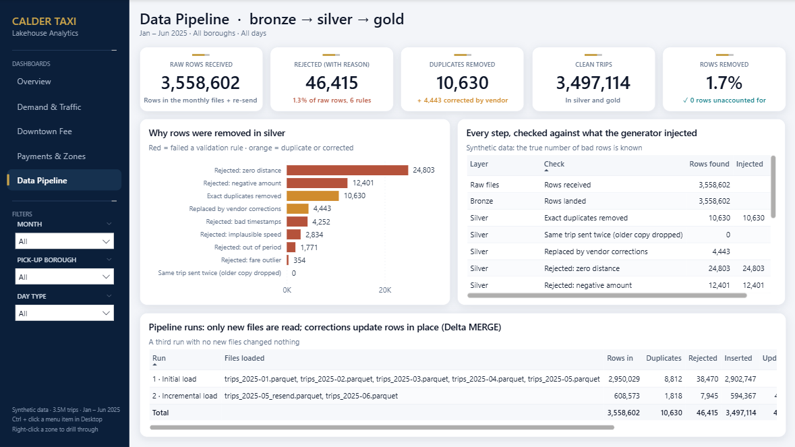

> **About the data.** The dataset is **synthetic**: 3.56 million trip records (Jan – Jun 2025) produced by a documented generator
> ([`scripts/generate_data.py`](scripts/generate_data.py)) modelled on the layout of public taxi trip files. It contains the
> problems real feeds have (negative fares, zero-distance trips, drop-off before pick-up, meter-clock dates, impossible speeds,
> typos, duplicates, unknown zone IDs, schema changes between months, and a vendor re-sending corrected records). Because the
> generator records exactly what it injected ([`data_raw/true_effects.json`](data_raw/true_effects.json)), every cleaning step
> and every finding is **checked against the truth**.

## Key results

| | Result | So what |
|---|---|---|
| 1 | **3,558,602 raw rows → 3,497,114 clean trips, with all 61,488 removed rows explained**: 46,415 rejected by 6 rules (each with a reason), 10,630 duplicates, 4,443 old versions replaced by vendor corrections. 0 rows unaccounted for; gold totals equal silver to the trip. | Numbers downstream can be trusted and audited. |
| 2 | **Every rejection count equals the number of bad rows the generator planted**, rule by rule (e.g. 24,803 zero-distance trips found, 24,803 injected). | The validation rules catch exactly what they should, nothing more. |
| 3 | **Incremental:** the June load read only the 2 new files (608,573 rows), inserted 594,367 trips and **updated 4,443 corrected 13 May trips in place** (Delta MERGE); gold rebuilt only May and June. A third run with no new files changed nothing. | Monthly runs cost one month of compute, and re-runs are safe. |
| 4 | **Delta time travel** shows what the vendor correction changed: 13 May vendor-2 revenue restated from $366,459 to $383,509 (**+$17,049**) and 171 missing trips added. | Restatements are traceable to a table version. |
| 5 | **The congestion fee cut trips touching Downtown by 7.0%** (95% CI 6.5–7.4%) relative to the rest of the city, while collecting **$2.95M** in Mar – Jun. Downtown's share of trips fell from 50.9% to 48.9%. | The fee works as intended, without hurting the rest of the network. |
| 6 | **Rain adds 12.2% trips and slows traffic 11.2%** (41 rainy days; same weekday and month). | Put more cabs on the road on rainy days, and expect longer trips. |
| 7 | **Weekday demand peaks at 18:00 (1,324 trips/hour) when traffic is slowest (10 mph at 17:00, vs 20 mph at night)**; weekends peak at 22:00 with 2.2x the weekday late-night demand. | Shift planning: evening rush on weekdays, nightlife on weekends. |
| 8 | **Card share rose from 69.9% to 75.0%**; card riders tip 20.6% of the fare (cash tips are not recorded, so tips are analysed on card trips only). **Airport trips are 3.5% of trips but 7.2% of revenue.** | Card is the norm; airports are the most valuable trips. |

The generator's true effects are −7% (fee), +12% demand / −12% speed (rain): the estimates recover them.

## Architecture

```
 landing/ (volume)            BRONZE (Delta)                 SILVER (Delta)                       GOLD (Delta)
 trips_2025-01.parquet  ──►  trips          raw rows +   ──►  trips            validated, deduped ──►  daily_kpis
 ...                         lineage, conformed schema         MERGE on trip_id, partitioned           zone_daily
 trips_2025-06.parquet       ingest_log     files loaded       by month                                hourly_demand
 trips_2025-05_resend        zones, weather                    trips_rejected   row + reason            payment_summary
 zones.csv, weather.csv                                        batch_log        counts per batch       borough_flows
                                                               zones, weather                          downtown_daily
                                                                                                       data_quality, findings
```

| Notebook | What it does |
|---|---|
| [`00_config`](notebooks/00_config.py) | Paths and helpers; the only code that differs between Databricks (Unity Catalog tables, volume) and local Spark (Delta folders) |
| [`01_bronze`](notebooks/01_bronze.py) | Loads **only files not loaded before** (ingest log); conforms names and types across schema versions (`Airport_fee` → `airport_fee`, `passenger_count` bigint → double, `cbd_congestion_fee` added as null before March) and logs each change; adds `_source_file`, `_batch_id`, `_ingested_at` |
| [`02_silver`](notebooks/02_silver.py) | 6 validation rules (first failing rule is the reason) → `trips_rejected`; exact-duplicate removal; latest version wins per `trip_id`; unknown zones and missing passenger counts kept and flagged; zone join (broadcast); derived duration, speed, tip %; **Delta MERGE** (update corrected trips, insert new) with insert/update counts from the commit metrics |
| [`03_gold`](notebooks/03_gold.py) | Six business tables; rebuilds **only the months touched** by new batches (`replaceWhere`); stores sums next to averages so any level can be re-aggregated exactly |
| [`04_quality_and_history`](notebooks/04_quality_and_history.py) | Reconciliation asserts (fails the job if any row is unaccounted for), rejection counts vs the injected truth, `DESCRIBE HISTORY`, time travel (`VERSION AS OF`) on the vendor correction, `OPTIMIZE … ZORDER BY (pickup_date, pu_location_id)` |
| [`05_analysis`](notebooks/05_analysis.py) | Spark SQL on gold + small regressions: fee effect (difference-in-differences with weekday controls), rain effect, hourly demand, payments, airports, zones → `gold.findings` |

**Databricks deployment:** [`databricks.yml`](databricks.yml) is a Databricks Asset Bundle that deploys the notebooks and a
4-task job (bronze → silver → gold → quality) on serverless compute with a file-arrival trigger on the landing volume.
Step-by-step for Databricks Free Edition: [`databricks/SETUP.md`](databricks/SETUP.md). The code avoids what serverless does
not allow (RDDs, `cache()`, `sparkContext`).

### Verified on Databricks

The same notebooks were deployed with the bundle to a Databricks Free Edition workspace (serverless compute, Unity Catalog)
by [`databricks/run_on_databricks.ps1`](databricks/run_on_databricks.ps1) and run three times. Every task succeeded, and
every number matches the local run exactly:

| Check | Databricks | Local Spark |
|---|---:|---:|
| Bronze rows (`taxi_bronze.trips`) | 3,558,602 | 3,558,602 |
| Clean trips (`taxi_silver.trips`) | 3,497,114 | 3,497,114 |
| Rejected with a reason (`taxi_silver.trips_rejected`) | 46,415 | 46,415 |
| Run 2: inserted / updated by MERGE | 594,367 / 4,443 | 594,367 / 4,443 |
| Findings (`taxi_gold.findings`, 14 rows) | identical | identical |
| Job run time: initial / incremental / re-run | 3m 26s / 2m 12s / 1m 24s | |

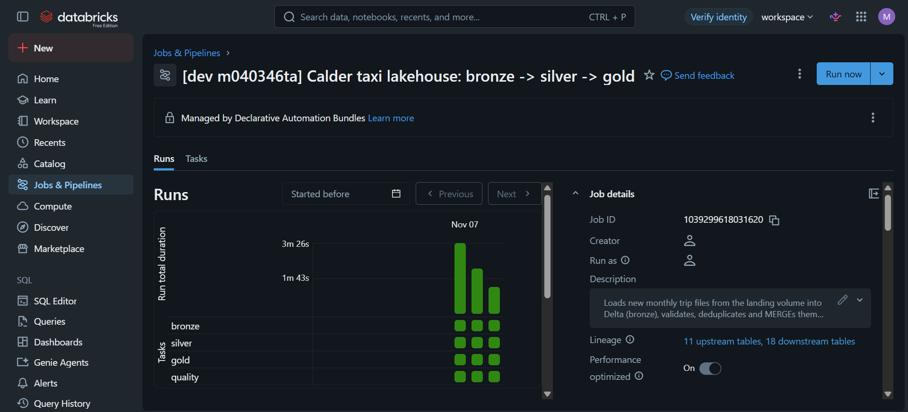

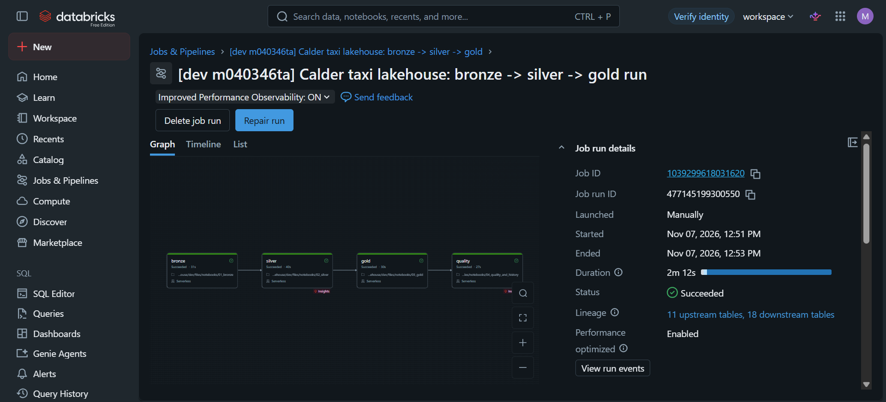

### The three runs

| Run | Files landed | Rows in | Duplicates | Rejected | Inserted | Updated | Gold months rebuilt |
|---|---|---:|---:|---:|---:|---:|---|
| 1 · Initial load | Jan – May | 2,950,029 | 8,812 | 38,470 | 2,902,747 | 0 | all (first build) |
| 2 · Incremental | June + 13 May re-send | 608,573 | 1,818 | 7,945 | 594,367 | 4,443 | May, June |
| 3 · Re-run | none | 0 | | | 0 | 0 | none |

Full log of the three runs: [`data_clean/pipeline_run_log.txt`](data_clean/pipeline_run_log.txt).

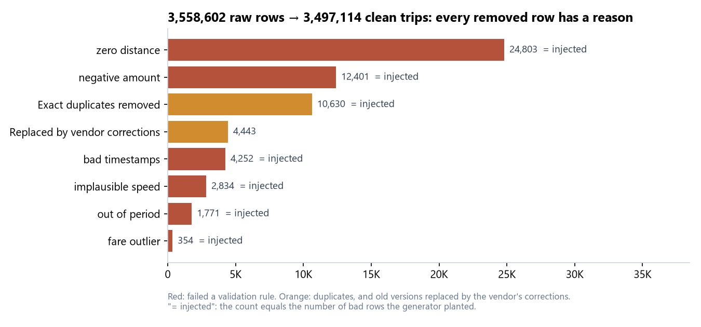

## Findings

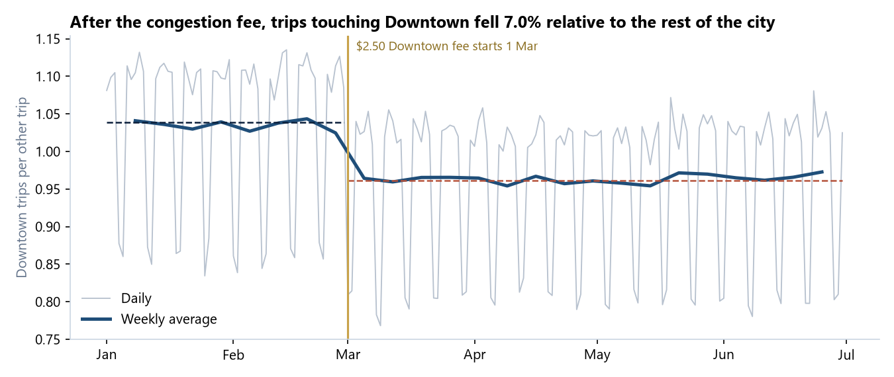

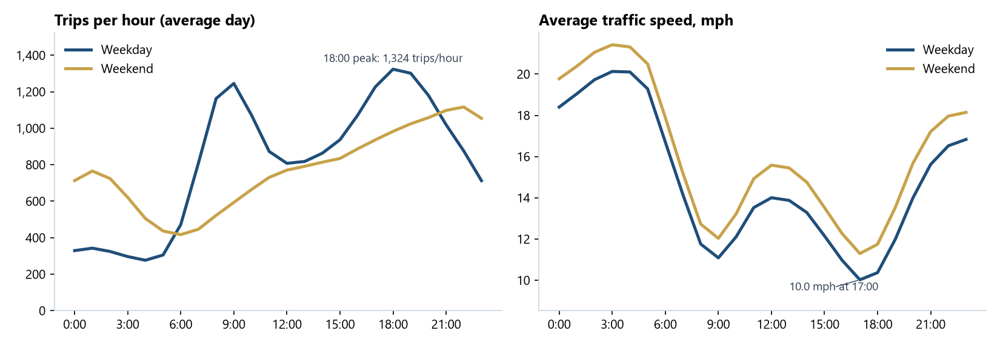

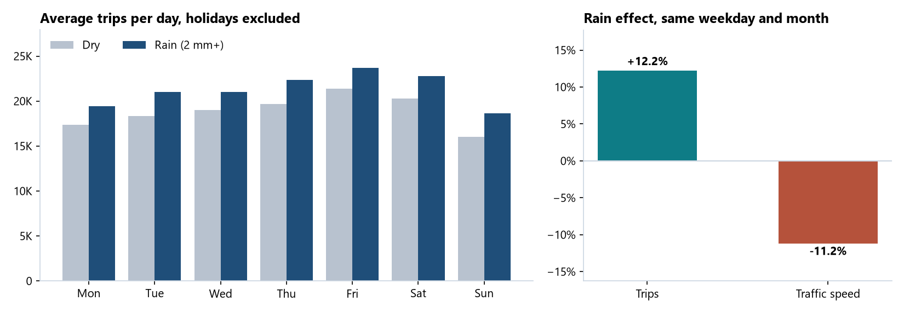

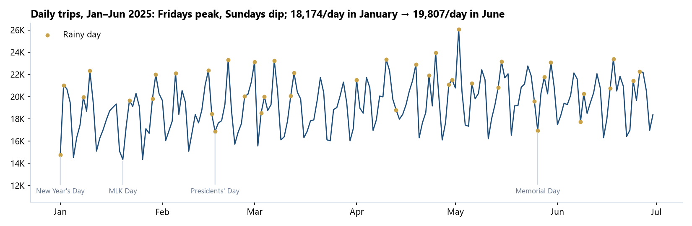

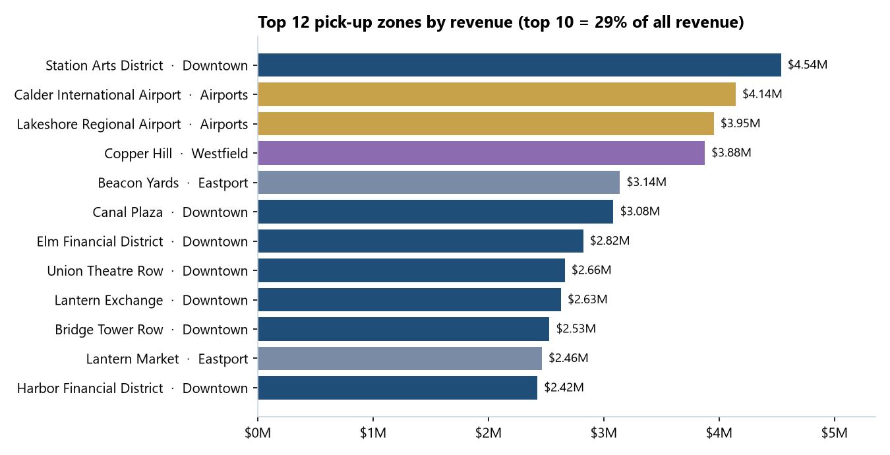

## Power BI dashboard

Built on the gold tables, in the same executive design system as the other portfolio dashboards: custom theme, sidebar
navigation, synced Month / Borough / Day-type filters, KPI tiles, dynamic titles, a **Zone Detail** drill-through and a day
tooltip. Details: [`powerbi/DESIGN.md`](powerbi/DESIGN.md).

| Overview | Demand & Traffic |
|---|---|
| 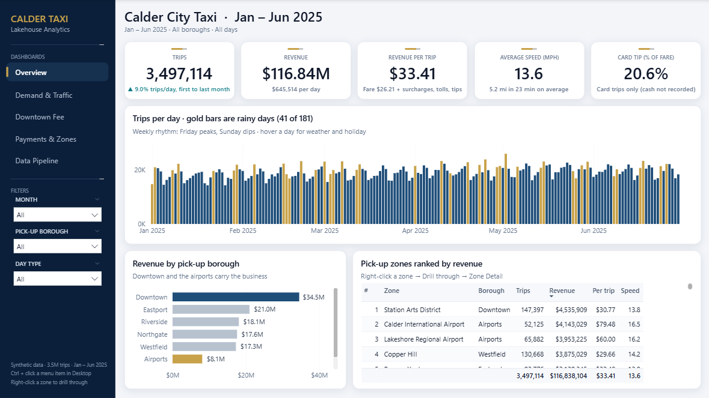 | 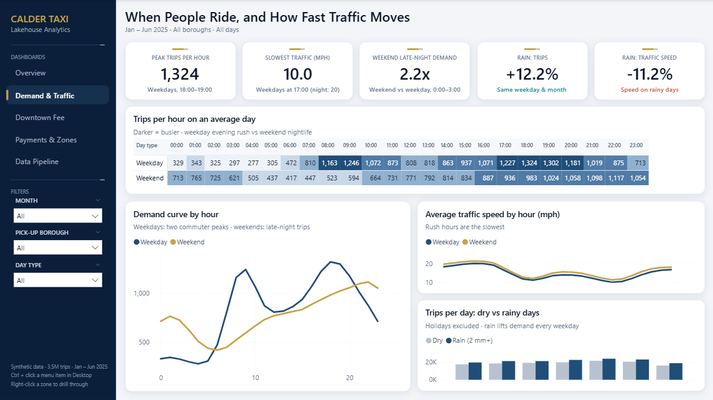 |
| **Downtown Fee** | **Payments & Zones** |
| 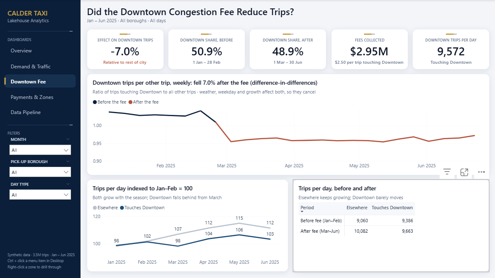 | 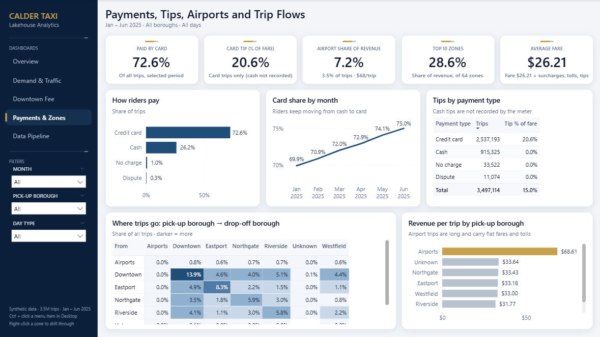 |

* **Model:** 5 fact and 5 dimension tables from gold (star schema), plus data-quality, pipeline-run and findings tables;
  110 measures; every average recomputed from additive sums. Measure totals match Spark exactly (3,497,114 trips,
  $116,838,104 revenue, 0 rows unaccounted for).
* Saved as a **Power BI Project** ([`powerbi/CalderTaxi.pbip`](powerbi/CalderTaxi.pbip)) generated by
  [`scripts/build_pbip.py`](scripts/build_pbip.py). On Databricks, connect the same model to `workspace.taxi_gold`.

## How to run

**On Databricks:** see [`databricks/SETUP.md`](databricks/SETUP.md) (upload the files to the volume, `databricks bundle deploy`,
`databricks bundle run taxi_lakehouse`).

**Locally** (Spark 4.2 + Delta Lake 4.4, Java 17):
```bash
pip install pyspark delta-spark pandas numpy pyarrow matplotlib
python scripts/generate_data.py    # synthetic raw files -> data_raw/   (~1 min, seeded)
python scripts/run_local.py        # runs the notebooks: initial load, incremental load, re-run, analysis (~12 min)
python scripts/make_charts.py      # README charts
python scripts/build_pbip.py       # Power BI project -> powerbi/CalderTaxi.pbip
```
[`scripts/local_spark.py`](scripts/local_spark.py) builds the Spark session; its docstring lists the extra setup Windows needs
(Hadoop `winutils`), which Databricks does not. Raw files (118 MB) are not committed; the generator recreates them exactly.

## Tools
PySpark · Delta Lake (MERGE, time travel, OPTIMIZE/Z-order, schema evolution, replaceWhere) · Databricks (notebooks, Unity
Catalog, volumes, Asset Bundles, Jobs) · Spark SQL · Python (pandas, NumPy, matplotlib) · Power BI (DAX, Power Query, PBIP/TMDL)
